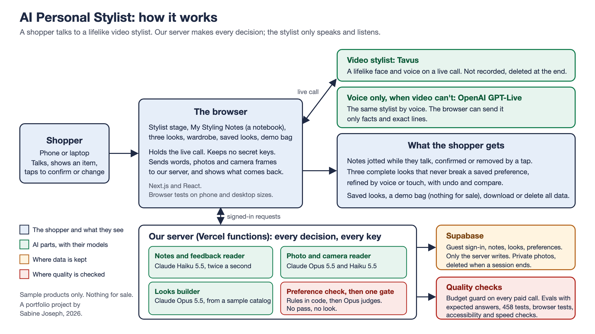

# AI Personal Stylist

**A video AI stylist that remembers what you said and won't show you what you ruled out.** A working web app for anyone dressing for an occasion on their phone.

By Sabine Joseph, AI product manager. [Live app](https://ai-personal-stylist-inky.vercel.app) · [Demo video](#demo) · [One-page case study (PDF)](docs/case-study.pdf) · [Evaluation](docs/evaluation.md) · [How to run it](docs/how-to-run.md)

> The stylist, the notes, the looks and the preference check are real. The products are a sample catalog of about 140 items with generated photos: nothing is for sale, and no retailer is connected. Built and live; the last launch check, a stranger's first session, is still to run.

## Demo

A real session with the video stylist, using the sample profile: the notes as she takes them, three complete looks, a change and its undo, a piece from my own wardrobe shown on camera and styled around, Behind the scenes (what was captured and how each look was checked), and the privacy page. 2 minutes 13 seconds, with sound.

https://github.com/user-attachments/assets/d4ee8b8a-1dc7-43db-9bde-858ca3c55bda

## At a glance

- **The user and the problem:** Anyone dressing for an occasion who shops on their phone. Online shopping gives a search box and a thousand results that don't go together, and AI assistants forget the budget you gave and show you what you ruled out.
- **What it does:** You talk face to face with a video stylist. She takes notes as you speak, which you confirm with a tap, and builds three complete looks within your budget and your rules, around a piece you already own if you show it.
- **How it works:** A fast small model (Claude Haiku 5.5) and plain code read the notes while you talk. A larger one (Claude Opus 5.5) reads photos and builds the looks. Every look passes one gate, rules in code and then a judgment call, before you see it. Video and voice come from Tavus and OpenAI; every decision is made on my server.
- **How quality was defined:** Targets with numbers for the notes, the looks, the photos, speed and cost, set on 17 October 2026 before any result existed, and never moved.
- **Results:** 96% of notes right and 97% within 2 seconds (in-sample), 16 of 16 planted rule breaks caught, 93% of photo details right. Three targets were missed: the blind set of new sentences (83% right and 85% within 2 seconds, against 90% and 95%), interruption (0.7 seconds against 0.5) and AI cost per 10-minute demo (about $1.15 against $1.10).
- **Status:** Built and live, with no sign-up. The products are a sample catalog and nothing is for sale. The last launch check, a stranger's first session, timed, is still to run.
- **How it was built:** I wrote the specs, set the quality targets and made every product decision, and Claude Code wrote the code. Planning started on 7 October 2026 and building ran from 18 to 31 October: 73 pull requests, each tested automatically before it merged, with a check on my own phone and a code review at the end of every phase.

## The problem

Shopping for an outfit online means a search box, filters, and a thousand results that don't go together. A good stylist in a shop does the opposite: listens, remembers what you said, looks at what you already own, and puts a whole outfit together within your budget and your rules.

AI assistants manage the listening half. Where they fail is memory and consistency: they forget the budget you gave two messages ago, contradict a preference you stated, and show you the high heels you said you never wear.

The problem is my own. I shop for occasion outfits on my phone, and that is how every search box and chat assistant has failed me. I haven't done user research beyond that yet: a friend's first try, timed, is the first outside evidence and the last launch check.

## How it works

1. **Try the demo.** A guest sign-in with a bot check, no account. A short setup, or a sample profile with a budget and three saved preferences, such as "Never: high heels".
2. **Talk to the stylist.** A lifelike video stylist answers on a live call. As you speak, she jots notes in **My Styling Notes**: "Outdoor wedding, November", "Budget: up to $500". A new note is in pencil; a tap turns it to ink, which means confirmed; a correction by voice rewrites it.
3. **Show what you own.** A photo, or the live camera, which names the item. The looks are built around it.
4. **Three looks appear**, each checked against your saved preferences and confirmed notes before you see it. Keep or change a piece, swap it, undo, compare earlier versions. Your own items are never in the totals.
5. **Keep what you like.** Save a look, put sample pieces in a demo bag that cannot check out, download everything the app holds, or delete it all.



Underneath: the browser holds the call and sends your words, photos and camera frames to my server. The server reads notes with a fast small model (Claude Haiku 5.5) and plain code for money and dates, reads photos and builds looks with a larger one (Claude Opus 5.5), and runs every look through one gate: rules in code, then a judgment call for the rest. A budget guard checks every paid call against a daily allowance per visitor and monthly stops per service.

## Key decisions and what they cost

- **A notebook, not a form.** The stylist writes free-form notes in her own words, and nothing becomes a rule until you confirm it. The cost: a notes reader that has to be fast and right while you're still talking, which took a model comparison and two rounds of tuning.
- **The stylist only speaks and listens.** Video and voice come from Tavus and OpenAI through one swappable connector; every decision is made on my server, where the keys live. The cost: she can't improvise a decision, and a switch from video to voice changes her voice.
- **One gate for every look.** Rules in code first (a heel height, a budget, a size), then a judgment by a large model for the rest. No look reaches the screen without a passing check. The cost: about 2 cents and 6 seconds per judgment, most of a demo's AI cost.
- **Accuracy first, then speed, then cost.** Four models were measured on the same sentences before any screen was built. Opus was right every time but too slow for live notes; Haiku with better instructions and code for money and dates was fast and right.
- **Degrade, never break.** If video is busy or out of minutes, the same stylist carries on by voice and says why. If a check can't run, the look is held with a plain reason rather than shown unchecked.
- **Privacy as a feature.** Calls are never recorded, the camera is never sent to the video service, session photos are deleted when the session ends, and a shopper can download or delete everything. The cost: a saved look keeps your own item by name, not its photo.

## What I left out of v1, and why

- **No retailer, no checkout.** A sample catalog of about 140 items with generated photos keeps the demo free of real stock, prices and retailer terms while the product idea is tested. Links come with the business model below.
- **Voice only in the conversation.** No captions and no typing to the stylist yet, so people who are deaf, hard of hearing or can't speak can't use the conversation. Everything outside it works by touch or keyboard. The first accessibility item after launch.
- **One video call at a time.** The video plan allows one; a second visitor gets the same stylist by voice, which sounds different.
- **Android not tested.** One iPhone and one laptop, mine.

## Business model, after v1

**Affiliate commission from high-end retailers.** Each piece in a look would link to the retailer's own site through its affiliate program, and the app would earn a commission on what the shopper keeps, assumed at 5%. My hypothesis is that a video stylist's more personal styling suits higher-ticket items, so the target is a retailer such as FWRD. The shopper pays the retailer's price; the retailer handles checkout, delivery and returns. v1 has no links.

**Does a session pay for itself?** A 10-minute session costs about $0.95 to $1.65 with the voice stylist and $3.95 to $4.65 with the video stylist: $0.45 to $1.15 of Claude, plus OpenAI voice at $0.05 a minute or Tavus video at $0.35 a minute. Hosting isn't counted. FWRD's average order was about $640 in 2025, before returns (Revolve Group's 2025 annual report): about $32 at 5%.

| A 10-minute session | Cost to run | Kept spend to break even at 5% | In average FWRD orders ($32 each) |
|---|---|---|---|
| Voice stylist | $0.95 to $1.65 | $19 to $33 | One in every 19 to 34 sessions |
| Video stylist | $3.95 to $4.65 | $79 to $93 | One in every 7 or 8 sessions |

**The riskiest assumption** is that one in 7 or 8 video sessions ends in a kept order: far above usual online shopping conversion, and returned orders earn nothing. A $300 basket would need one in 3 or 4, which is why the target is high end. It is the first thing to measure with real shoppers. The app is ready: every product already has an empty purchase link and a "can be bought" flag, so a retailer's feed is a new connector, not a redesign.

## How I defined and measured quality

**Targets first.** I wrote what good looks like, with numbers, at planning time (17 October 2026) and in each task's plan before its evaluation ran, and never moved a target after a result arrived. The full write-up, with every target's date and caveat, is [docs/evaluation.md](docs/evaluation.md).

**How.** Scripts with expected answers, run against the real models and timed: 63 shopper sentences replayed at speaking pace, 37 looks from the real catalog with 16 rule breaks planted on purpose, 24 catalog photos, 16 preferences. Two words matter in the table. **In-sample** means the reader was scored on sentences I had used while tuning it, like knowing the exam questions. **Blind** means a separate Claude Code conversation, which never touched the notes reader, wrote 15 new sentences and ran them once.

| Measure | Target | Result | Caveat |
|---|---|---|---|
| Notes within 2 seconds of their phrase | 95% | 97% | In-sample; a few points of variation between runs |
| Notes right (the note, its status, no repeats, the next question) | 90% | 96% | In-sample |
| Notes on the blind set | 90% right, 95% within 2 s | 83% right, 85% within 2 s | **Not met.** 15 sentences, one run; the honest estimate for new sentences |
| Rule breaks caught by code | All | 16 of 16 | Planted by me |
| Judged looks right | 90% | 21 of 21 | A small set, reviewed by me |
| Photo details right | 85% | 93% | Catalog photos, cleaner than phone photos |
| Interruption: talking over the stylist stops her | 0.5 s | 0.7 s by button | **Not met.** One measurement; by voice it felt immediate but wasn't timed |
| AI cost per 10-minute demo | About $1.10 | About $1.15 | **Not met**, by 5 cents; one session with styling changes. A session with no changes was about $0.45, measured on 20 October before styling changes existed |
| Phone speed (Lighthouse) on the welcome screen | 90 | 98 | From a Mac, not a real phone's network |

**What the results changed.** The notes model (Opus was right but too slow, so Haiku with code for money and dates) and its setup (thinking off and words sent twice a second took on-time notes from about half to 97%). The daily AI allowance, after a session with styling changes stopped my own check: it went to $3 and the screens say when it's used up. Undo and Compare now reuse a look's passing verdict instead of paying for it again. The blind set's misses are the first fixes after launch, in a conversation that never reads the blind cases.

## Limitations

- **The evaluation is mostly in-sample**, and the one blind set missed both targets. Treat 83% right and 85% within 2 seconds as the estimate for new sentences.
- **One tester.** Every real-device check was mine, on one iPhone and one laptop. No stranger has used it yet.
- **Not measured:** whether shoppers like the looks (the check tests rules and stated preferences, not taste), whether sessions lead to purchases (no links yet, so the business model is untested), and busy periods. Costs depend on behaviour: $0.45 to $1.15 of AI a session, so the 15-minute, $3-a-day limits per visitor are what keep a public link safe.

## Planned and tested like a product

- **Project Memory:** [product spec](docs/product-spec.md), [design](docs/design.md), [tech spec](docs/tech-spec.md), [phased plan with progress](docs/progress.md) and [MVP scope, decisions and risks](docs/mvp.md), each agreed before building and kept current. Also published as a [website](https://claude.ai/artifact/Ngtm5cTyekAP1cPikjmhuX) with live plan ticks.
- **Risk first:** the first phase tested the video stylist, live notes on four models, the camera, costs and the providers' data handling before any screen was built, with pass marks written down first.
- **Automated checks:** 458 unit and database tests, about 200 browser tests on phone and desktop sizes with fake engines, an accessibility scan on every page, and the package checks (`python3 checks/run_all.py`).

## Run it yourself

Open [the live site](https://ai-personal-stylist-inky.vercel.app) on a phone, tap **Try the demo**, allow the microphone, and say what you're dressing for. The aim is a first look within 3 minutes. To run your own copy, see [docs/how-to-run.md](docs/how-to-run.md).

## Repository structure

```
app/            Pages and API routes (Next.js)
components/     Screens: the stylist stage, the notebook, looks, wardrobe, bag, profile
core/           Plain logic with no services: notes, looks, the preference check, rules
lib/            Server services: sessions, notes, photos, looks, budget guard, privacy
connectors/     Swappable connectors: conversation (Tavus, OpenAI, a fake), AI (Claude), catalog
supabase/       Database tables and functions, as migrations
tests/          Unit and database tests, and the evaluations with their saved results
e2e/            Browser tests on phone and desktop sizes
docs/           The plan files, the evaluation, the diagram, the case study, the run guide
checks/         Package checks and the pre-publish scan (Python standard library)
scripts/        Lighthouse, the evaluation summary, Tavus setup
tools/          The Memory site builder
```
