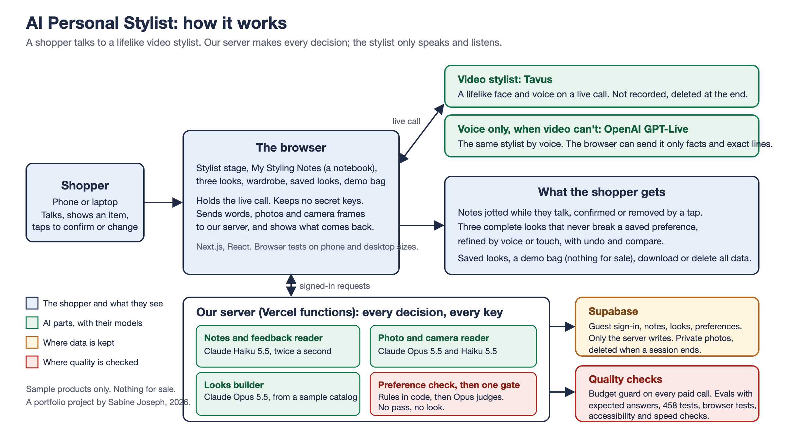

# AI Personal Stylist

**A lifelike video stylist that jots down what you want while you talk, then builds complete looks you refine by voice or touch. For anyone shopping for an outfit on their phone.**

> **Portfolio case study.** A working web app, live at [ai-personal-stylist-inky.vercel.app](https://ai-personal-stylist-inky.vercel.app), built by an AI product manager with Claude Code as the engineering partner. The stylist, the notes, the looks and the preference check are real. The products are a sample catalog of about 140 items with generated photos: nothing is for sale, and no retailer is connected.

## Demo

A real session with the video stylist, using the sample profile: the notes as she takes them, complete looks, a change and its undo, a piece from the shopper's own wardrobe shown on camera and styled around, Behind the scenes, and the privacy page. 2 minutes 14 seconds, with sound.

https://github.com/user-attachments/assets/d4ee8b8a-1dc7-43db-9bde-858ca3c55bda



## At a glance

- **The user and the problem:** someone dressing for an occasion on their phone. Search gives them a thousand results; a chat assistant forgets what they said and shows them things they ruled out.
- **What it does:** a face-to-face conversation with a video stylist who takes notes you can see and correct, builds three complete looks around what you own and what you said, and never shows a look that breaks a preference you confirmed.
- **How it works:** live video and voice from outside services that only speak and listen; a small server with Claude models reading notes, reading photos and building looks; a preference check that every look must pass before it reaches the screen.
- **How quality was defined:** targets written before any result, at planning time and in each task group's plan: 95% of notes within 2 seconds, 90% of notes right, every planted rule break caught, 85% of photo details right, about $1.10 of AI per demo, a phone speed score of 90.
- **Results:** 97% of notes within 2 seconds and 96% right, on sentences the builders had seen (in-sample); 16 of 16 planted rule breaks caught; 93% of photo details right on catalog photos; about $1.15 per demo with styling changes, 5 cents over target; a live speed score of 98. On a blind set of 15 new sentences the notes scored 83% right and 85% within 2 seconds, below both targets: the honest estimate for sentences nobody tuned for.
- **Status:** built and live, with the final launch check (a stranger's first session) still to run.

## The problem

Shopping for an outfit online means a search box, filters, and a thousand results that don't go together. A good stylist in a shop does the opposite: listens, remembers what you said, looks at what you already own, and puts a whole outfit together within your budget and your rules.

AI assistants manage the listening half. Where they fail is memory and consistency: they forget the budget you gave two messages ago, they contradict a preference you stated, and they show you the high heels you said you never wear. This project asks whether a conversation with an AI stylist can feel understood, never contradict you, and get you to a look you love in a few minutes on a phone.

## How it works

1. **Try the demo.** A guest sign-in with a bot check, no account. A short setup, or a sample profile with a budget and three saved preferences, such as "Never: high heels".
2. **Talk to the stylist.** A lifelike video stylist answers on a live call. As you speak, she jots notes in **My Styling Notes**: "Outdoor wedding, November", "Budget: up to $500". Pencil means to confirm; a tap turns it to ink; a correction by voice rewrites it.
3. **Show what you own.** A photo, or the live camera, which names the item and takes a still. The looks are built around it.
4. **Three looks appear**, each checked against your saved preferences and confirmed notes before you see it. Keep or change a piece, swap it, undo, compare earlier versions. Your own items are never in the totals.
5. **Keep what you like.** Save a look, put sample pieces in a demo bag that cannot check out, download everything the app holds, or delete it all.

Underneath: the browser holds the call and sends your words, photos and frames to our server. The server reads notes with a fast small model (Claude Haiku 5.5) and plain code for money and dates, reads photos and builds looks with a larger one (Claude Opus 5.5), and runs every look through one gate: rules in code, then a judgment call for the rest. A budget guard checks every paid call against a daily allowance per visitor and monthly stops per service. The [diagram](docs/architecture.png) shows the parts.

## Key design choices and tradeoffs

- **A notebook, not a form.** The stylist writes free-form notes in her own words, and nothing becomes a rule until you confirm it. What it cost: a notes reader that has to be fast and right while you're still talking, which took a model comparison and two rounds of tuning.
- **The stylist only speaks and listens.** Video and voice come from Tavus and OpenAI through one swappable connector; every decision is made by our server, where the keys live. What it cost: the stylist is told what she knows by our server, so she can't improvise a decision, and a switch from video to voice changes her voice.
- **One gate for every look.** Rules in code first (a heel height, a budget, a size), then a judgment by a large model for the rest, and no look reaches the screen without a passing check. What it cost: about 2 cents and 6 seconds per judgment, which is most of a demo's AI cost.
- **Accuracy first, then speed, then cost.** Four models were measured on the same sentences before any screen was built. Opus was right every time but too slow for live notes; Haiku with better instructions and code for money and dates was fast and right.
- **Degrade, never break.** If video is busy or out of minutes, the same stylist carries on by voice, saying why. If a check can't run, the look is held with a plain reason rather than shown unchecked.
- **Privacy as a feature.** Calls are never recorded, the camera is never sent to the video service, session photos are deleted when the session ends, and a shopper can download or delete everything. What it cost: a saved look keeps your own item by name, not its photo.

## How quality was defined and measured

**What good looks like (set before any result).** Written at planning time (17 October 2026) and in each task group's plan before its evaluation ran. Targets never moved after results arrived.

| Measure | Target | Set on |
|---|---|---|
| Notes within 2 seconds of their phrase | 95% | 17 Oct 2026 |
| Notes right (the note, its status, no repeats, the next question) | 90% | 20 Oct 2026 |
| Planted rule breaks caught by code | All | 21 Oct 2026 |
| Judged looks right | 90% | 21 Oct 2026 |
| Photo details right | 85% | 20 Oct 2026 |
| AI cost per 10-minute demo | About $1.10 | 17 Oct 2026 |
| Phone speed (Lighthouse) on the welcome screen | 90 | 17 Oct 2026 |

**How it was measured.** Scripts with expected answers, run against the real models and timed: 63 shopper sentences replayed at speaking pace, 37 looks from the real catalog with 16 planted rule breaks, 24 catalog photos with answers from the catalog's own details, 16 preferences. One extra set of 15 sentences was written and run by a separate session that never touched the notes reader. The cost came from the live app's usage table for one full session. `node scripts/eval-summary.mjs` prints the headline numbers from the saved results.

**Results.**

| Measure | Target | Result | Caveat |
|---|---|---|---|
| Notes within 2 seconds | 95% | 97% | In-sample; a few points of variation between runs |
| Notes right | 90% | 96% | In-sample: the answers were seen by the sessions that built the reader |
| Notes on the blind set | 90% right, 95% within 2 s | 83% right, 85% within 2 s | Not met. 15 sentences, one run; 5 notes never appeared, in a long turn a later reading removed |
| Rule breaks caught by code | All | 16 of 16 | Planted by the builder |
| Judged looks right | 90% | 21 of 21 | A small set, reviewed by the builder |
| Photo details right | 85% | 93% | Catalog photos, cleaner than phone photos |
| AI cost per demo | About $1.10 | About $1.15 | Not met, by 5 cents; one session, with styling changes |
| Phone speed | 90 | 98 | Lighthouse from a Mac, not a real phone's network |

**What the results changed.** The notes model (Opus was right but too slow, so Haiku with code for money and dates). The notes setup (thinking off and words twice a second took on-time notes from about half to 97%). The daily AI allowance (a session with styling changes cost about $1 of judgments, which stopped the builder's own check; the allowance went to $3 and the screens say when it's used up). Undo and Compare now reuse a look's passing verdict instead of paying for it again. The planned speed work became a measurement, because the live site already scored 98. The blind set's misses (notes lost in a long turn, a stretched budget, a venue correction) are the first items for after launch, in a session that never reads the blind cases.

**How blind was it?** Not very, apart from one set. Every in-sample answer was written by the same builder who built the reader, often in the same task group. The photo answers come from the catalog's own details. The blind set is small, and it scored well below the in-sample numbers, which is the point of having one. The full write-up says what each number can and can't show: [docs/evaluation.md](docs/evaluation.md).

## Planned and tested like a product

- **Project Memory:** [product spec](docs/product-spec.md), [design](docs/design.md), [tech spec](docs/tech-spec.md), [phased plan with progress](docs/progress.md) and [MVP scope, decisions and risks](docs/mvp.md), each agreed before building and kept up to date. Also published as a [website](https://claude.ai/artifact/Ngtm5cTyekAP1cPikjmhuX) with live plan ticks.
- **Risk first:** Phase 0 tested the video stylist, live notes on four models, the camera, costs and the providers' data handling before any screen was built, with pass marks written down first.
- **Automated checks:** 458 unit and database tests, about 200 browser tests on phone and desktop sizes with fake engines (free and repeatable), an accessibility scan on every page plus 44 px touch targets and 200% text, and the portfolio checks (`python3 checks/run_all.py`). A code review at the end of every phase, with its findings fixed before the phase was called done.
- **Budget and privacy built in:** a daily allowance per visitor and monthly stops per service, checked before every paid call; no recordings, private photos deleted with the session, download and delete all.
- **One-page case study:** [docs/case-study.pdf](docs/case-study.pdf).

## Run it yourself

Open [the live site](https://ai-personal-stylist-inky.vercel.app) on a phone, tap **Try the demo**, allow the microphone, and say what you're dressing for. Three minutes to the first look. To run your own copy, see [docs/how-to-run.md](docs/how-to-run.md).

## Limitations

- **The evaluation is mostly in-sample.** The expected answers were written by the builder, and the notes reader was tuned on the sentences it was then scored on. One blind set of 15 sentences is the exception, and it missed both targets (83% right, 85% within 2 seconds).
- **One tester.** Every real-device check was by the builder on one iPhone and one laptop. No stranger has used it yet: that first session is the last launch check.
- **The conversation needs a voice.** There are no captions and no typing to the stylist in v1, so people who are deaf, hard of hearing or can't speak can't use the conversation. Everything outside it works by touch or keyboard.
- **A sample catalog.** About 140 products with generated photos, no real retailer, no real stock or prices, and no checkout by design.
- **One video call at a time.** The Tavus plan allows one; a second visitor gets the same stylist by voice, which sounds different.
- **Costs depend on behaviour.** A session with several styling changes costs about $1.15 of AI; one with none about $0.45. The 15-minute, $3-a-day limits per visitor are what keep a public link safe.
- **Not measured:** whether shoppers like the looks (the check tests rules and stated preferences, not taste), Android phones, and busy periods.

## Skills demonstrated

Writing a product spec, a design spec and a tech spec from a PRD, and keeping them honest as the plan changed. A phased plan with the risky parts first. Success metrics set before results, and an evaluation reported with its limits. Model choice from measured accuracy, speed and cost. Cost control, privacy by design and accessibility as requirements, not afterthoughts. Running phone checks and code reviews every phase. Building a real product as a non-developer, directing Claude Code with plain-English plans, decisions and checks.

## Repository structure

```
app/            Pages and API routes (Next.js)
components/     Screens: the stylist stage, the notebook, looks, wardrobe, bag, profile
core/           Plain logic with no services: notes, looks, the preference check, rules
lib/            Server services: sessions, notes, photos, looks, budget guard, privacy
connectors/     Swappable connectors: conversation (Tavus, OpenAI, a fake), AI (Claude), catalog
supabase/       Database tables and functions, as migrations
tests/          Unit and database tests, and the evaluations with their saved results
e2e/            Browser tests on phone and desktop sizes
docs/           The plan files, the evaluation, the diagram, the case study, the run guide
checks/         Portfolio checks and the pre-publish scan (Python standard library)
scripts/        Lighthouse, the evaluation summary, Tavus setup
tools/          The Memory site builder
```
